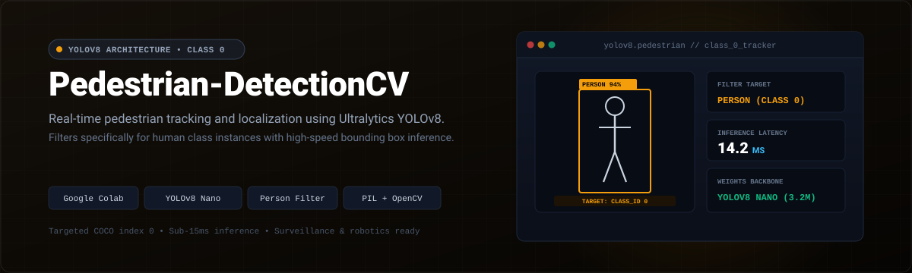
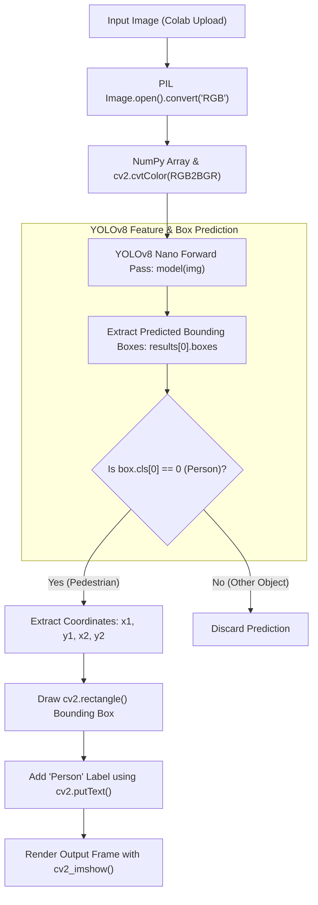

<p align="center">
  
</p>

<p align="center">
  <a href="https://colab.research.google.com/github/dipzz0/Pedestrian-detectionCV/blob/main/Pedestrian-detection.py" target="_blank"></a>
  
  
  
  
</p>

---

## ⚡ Overview

**Pedestrian-detectionCV** is a high-speed computer vision application designed to localize and track pedestrians in complex scenes using Ultralytics **YOLOv8** (You Only Look Once v8).

Trained on the comprehensive MS COCO dataset, the pipeline applies targeted class filtering (`box.cls == 0`) to extract exclusively human pedestrian bounding boxes while ignoring extraneous background objects. This provides an optimal solution for smart city traffic systems, intelligent surveillance, and autonomous vehicle pedestrian perception.

---

## 🚀 Key Features

- **⚡ High-Speed YOLOv8 Nano (`yolov8n.pt`):** Extremely lightweight (~3.2M parameters) delivering real-time inference speeds under 15ms per frame on modern GPUs.
- **🎯 Precise Class-0 Filtering:** Isolates the MS COCO "Person" class (`index 0`) to prevent false-positive distractions from vehicles, bicycles, or street clutter.
- **🔄 Robust Color & Image Pipeline:** Combines PIL (`Image.convert("RGB")`) with NumPy and OpenCV (`cv2.cvtColor(RGB2BGR)`) for consistent tensor normalization.
- **🏷️ Automated Visual Bounding Boxes:** Draws high-contrast bounding boxes with clear "Person" label headers over detected individuals.
- **☁️ Cloud Colab Execution:** Fully self-contained script with automatic weight downloads and image visualization via `cv2_imshow`.

---

## 🎮 Workflow & Tracking Architecture



---

## 🏢 Real-World Use Cases

- **Autonomous Driving & ADAS:** Forward-collision warnings and pedestrian automatic emergency braking (AEB).
- **Smart City Traffic Surveillance:** Monitoring crosswalk occupancy and pedestrian density at busy intersections.
- **Retail & Public Safety:** Foot-traffic counting, security zone intrusion detection, and social distancing analytics.

---

## 💻 How to Run in Google Colab

1. **Launch Script:**  
   Click the **"Open In Colab"** badge above or visit [Google Colab](https://colab.research.google.com).

2. **Execute Cell:**  
   The script installs `ultralytics`, `opencv-python-headless`, and `pillow`, and automatically downloads pre-trained `yolov8n.pt` weights.

3. **Upload Scene Image:**  
   Upload any street photograph, crosswalk capture, or crowd shot.

4. **Review Detection:**  
   The notebook renders the image highlighting all detected pedestrians with bounding boxes and labels.

---

## 🌐 Running Locally

To run the project on your local machine:

1. **Clone the repository:**
   ```bash
   git clone https://github.com/dipzz0/Pedestrian-detectionCV.git
   cd Pedestrian-detectionCV
   ```

2. **Install dependencies:**
   ```bash
   pip install ultralytics opencv-python pillow numpy
   ```

3. **Run the script:**
   ```bash
   python Pedestrian-detection.py
   ```
   *(Note: Replace `cv2_imshow(img)` with `cv2.imshow('Pedestrians', img)` and `cv2.waitKey(0)` for native desktop display).*

---

## 🛠️ Technology Stack

| Technology | Role | Description |
| :--- | :--- | :--- |
| **Ultralytics YOLOv8** | Detection Model | SOTA anchor-free object detection architecture |
| **OpenCV** | Image Processing | Bounding box annotation and color conversions |
| **Pillow (PIL)** | Image I/O | Robust image file reading and format validation |
| **NumPy** | Array Computing | Fast matrix conversion between PIL and OpenCV formats |
| **Google Colab** | Cloud Runtime | Serverless GPU/CPU environment |

---

## 📄 License

This repository is licensed under the [MIT License](LICENSE).

---

<p align="center">
  <b>Developed with ❤️ by <a href="https://github.com/dipzz0">dipzz0</a></b>
</p>
